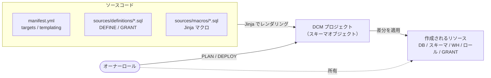

## TL;DR

- Snowflake の **DCM Projects** を、 **CLI（SQL）と Snowsight（Git ワークスペース）の両方** から PLAN / DEPLOY しました
- どちらの方法でも、ログや状態の管理がSnowsightで行えるのが便利です

## 環境

| 項目 | 内容 |
|---|---|
| Snowflake | Standardエディション、有償アカウント |
| Snowflake CLI | 3.25.0 |
| ソース管理 | 公開 GitHub リポジトリ + Snowflake の Git 連携（API Integration / Git Repository） |

## 参考にしたもの

- 公式チュートリアル: [Get Started with Snowflake DCM Projects](https://www.snowflake.com/en/developers/guides/get-started-snowflake-dcm-projects/)
- 今回作ったリポジトリ: https://github.com/alfortx/snowflake-dcm-sandbox

公式チュートリアルは Snowsight のワークスペースで進める構成です。今回はそれを参考に、自分の検証環境向けの定義を書き起こし、CLI と Snowsight の両方から動かしました。

## DCM について

DCM Projects は、Snowflake のオブジェクト（DB・スキーマ・WH・ロール・GRANT など）の「状態」を `DEFINE` 文で宣言し、PLAN（差分確認）→ DEPLOY（適用）で管理する「Snowflakeに閉じたIaC」です。今回の検証に関わるポイントだけ押さえておきます。

- **ディレクトリ構成が決まっている**: 定義は `sources/definitions/`、複数ファイルから使うマクロは `sources/macros/` に置きます。マクロファイルにはマクロ以外を書けません
- **Jinja が使える**: ループ・条件分岐・マクロで定義を組み立てられます。同じ構成をチームの数だけ並べる、といった用途に向いています
- **`manifest.yml` に設定を集約**: どの DCM プロジェクトに・どのテンプレート変数で展開するか（`targets` / `templating`）を書きます

CLI / Snowsight のどちらから実行しても、全体の構造は次のとおりです。



DCM の詳細は、さがらさんの以下の記事を参照してください。

https://dev.classmethod.jp/articles/snowflake-dcm-projects-ga/

## DCM でやったこと

仮想チーム（T1〜T3）× 環境（DEV / PRD）ごとに、**DB・スキーマ・WH・ロール** を Jinja のループで作りました。

### 構成と manifest

環境ごとに DCM プロジェクトを分け（`DCM_SBX_PROJECT_DEV` / `_PRD`）、同じ定義ファイルを `env_suffix` 違いで並べてデプロイします。1 つの DCM プロジェクトに別の構成をデプロイすると、前の構成のオブジェクトは削除されるため、公式も環境ごとにプロジェクトを分けることを推奨しています。

<details><summary>manifest.yml 全文（34行）</summary>

```yaml
manifest_version: 2
type: DCM_PROJECT
default_target: DCM_SBX_DEV

# 環境ごとに DCM プロジェクトを分け、同じ定義ファイルを env_suffix 違いで並べてデプロイする
# account_identifier は SQL（EXECUTE DCM PROJECT ... USING CONFIGURATION）での実行では参照されない。
# Snowflake CLI（snow dcm）で使う場合は自分のアカウント識別子に書き換える。
targets:
  DCM_SBX_DEV:
    account_identifier: MYORG-MYACCOUNT
    project_name: DCM_SBX_ADMIN_DB.PROJECTS.DCM_SBX_PROJECT_DEV
    project_owner: DCM_SBX_ADMIN_ROLE
    templating_config: DEV
  DCM_SBX_PRD:
    account_identifier: MYORG-MYACCOUNT
    project_name: DCM_SBX_ADMIN_DB.PROJECTS.DCM_SBX_PROJECT_PRD
    project_owner: DCM_SBX_ADMIN_ROLE
    templating_config: PRD

templating:
  defaults:
    wh_size: "X-SMALL"
    wh_auto_suspend: 60
    wh_statement_timeout: 180
    # チームごとに WH / ANALYTICS DB / ロール一式を展開する
    teams:
      - "T1"
      - "T2"
      - "T3"
  configurations:
    DEV:
      env_suffix: "_DEV"
    PRD:
      env_suffix: "_PRD"
```

</details>

チーム 1 つ分の定義はマクロにまとめ、`teams` をループして呼び出しています。WH の部分を抜粋すると次のとおりです。名前の組み立てと設定値は manifest の変数から来ています。

```sql




define warehouse {{wh}}
with
    warehouse_size = '{{wh_size}}'
    auto_suspend = {{wh_auto_suspend}}
    auto_resume = TRUE
    initially_suspended = TRUE
    statement_timeout_in_seconds = {{wh_statement_timeout}}
    comment = '{{team}} 用ウェアハウス';
-- （DB・スキーマ・ロール・GRANT が続く）

```

## CLI（SQL）で実行する

### 1. 事前準備

DCM プロジェクトはスキーマオブジェクトなので、先に作っておきます。Git 連携（API Integration / Git Repository）と DCM のオーナーロールもあわせて、リポジトリ内の `scripts/setup.sql` で作りました（ACCOUNTADMIN で実行）。

```sql
CREATE DCM PROJECT IF NOT EXISTS DCM_SBX_ADMIN_DB.PROJECTS.DCM_SBX_PROJECT_DEV;
CREATE DCM PROJECT IF NOT EXISTS DCM_SBX_ADMIN_DB.PROJECTS.DCM_SBX_PROJECT_PRD;
```

### 2. PLAN → DEPLOY

PLAN / DEPLOY 本体も Git 上のスクリプトにしておき、`EXECUTE IMMEDIATE FROM` で実行します。`USING (env => 'DEV')` を渡すと、スクリプト自体も Jinja として展開されます。

```sql
--!jinja
-- scripts/plan.sql（deploy.sql は PLAN を DEPLOY AS "..." に変えただけ）
EXECUTE DCM PROJECT DCM_SBX_ADMIN_DB.PROJECTS.DCM_SBX_PROJECT_{{ env }}
    PLAN
    USING CONFIGURATION {{ env }}
    FROM '@DCM_SBX_ADMIN_DB.GIT.DCM_SBX_REPO/branches/main/';
```

実行は次のとおりです。

```sql
ALTER GIT REPOSITORY DCM_SBX_ADMIN_DB.GIT.DCM_SBX_REPO FETCH;
USE ROLE DCM_SBX_ADMIN_ROLE;
USE WAREHOUSE DCM_SBX_ADMIN_WH;

EXECUTE IMMEDIATE FROM '@DCM_SBX_ADMIN_DB.GIT.DCM_SBX_REPO/branches/main/scripts/plan.sql'   USING (env => 'DEV');
EXECUTE IMMEDIATE FROM '@DCM_SBX_ADMIN_DB.GIT.DCM_SBX_REPO/branches/main/scripts/deploy.sql' USING (env => 'DEV');
```

:::note info
**補足: `plan.sql` の `{{ env }}` の仕組み**

[`EXECUTE IMMEDIATE FROM`](https://docs.snowflake.com/en/sql-reference/sql/execute-immediate-from) は、ステージや Git リポジトリに置いた SQL ファイルを読み込んで実行するコマンドです。ファイルの先頭に `--!jinja` を書くか `USING` で変数を渡すと、実行前にファイルを Jinja2 テンプレートとして展開してくれます（2026-10 時点で Preview の機能）。

- 変数は `USING (env => 'DEV')` のように `キー => 値` で渡します。渡せるのは文字列・数値・真偽値・NULL など
- `DRY_RUN = TRUE` を付けると、実行せずに展開後の SQL だけを返します。
- 公式ドキュメントに書かれているファイルの置き場所はステージと Git リポジトリだけですが、今回のように **ワークスペースのファイル**（`'snow://workspace/USER$.PUBLIC.DEFAULT$/versions/live/<パス>'`）も指定できました。

:::

### 3. PLAN の結果

PLAN / DEPLOY の結果は、**単一の JSON**（1 行 1 列）で返ってきます。作成・変更されるオブジェクトの一覧が `changeset` に入っています。

```json
{"version":2,"metadata":{"project_name":"DCM_SBX_ADMIN_DB.PROJECTS.DCM_SBX_PROJECT_DEV","role_name":"DCM_SBX_ADMIN_ROLE","command":"PLAN", ...},"changeset":[{"type":"ALTER","object_id":{"domain":"ROLE", ...}, ...}, ...]}
```

すごい行数が出てくるので、後述の Snowsight で見るのが楽です。

### 4. Snowsight でデプロイ結果を確認

CLI からデプロイした結果も、Snowsight の DCM プロジェクト画面（カタログ → DB → スキーマ → DCM プロジェクト）で確認できます。

デプロイ履歴には、変更件数（作成 50・変更 2）と使った構成（DEV）が記録されています。


「オブジェクト」タブには、DCM が管理しているオブジェクトの一覧が出ます。


「付与」タブでは、GRANT も管理対象として一覧できます。INHERITED grant は「継承された付与」として別枠で表示されます。


## Snowsight（Git ワークスペース）で実行する

### 1. Git ワークスペースを作る

ワークスペースの新規作成から「Git ワークスペース」を選び、リポジトリの URL と API Integration を指定します。公開リポジトリなので、認証は「Public repository」を選びました。


### 2. target を選んで「計画」を実行

画面下部のパネルを開くと、target と操作（計画 / プレビュー / 展開）を選ぶ欄があります。target を選んで「計画」を実行すると、`out/rendered/` に **Jinja をレンダリングした後の定義ファイル** が出力されます。マクロとループが実際にどう展開されたかを、ファイルのまま確認できます。


「系列」タブでは、ステージ → ビューのような依存関係を図で確認できます。


### 3. 「展開」でデプロイ

操作を「展開」に切り替えて実行します。「変数を上書き」をオンにすると、manifest の変数をその場で差し替えられます。


デプロイ履歴を SQL で確認すると、Snowsight からのデプロイのソースは `snow://workspace/"USER$"."PUBLIC"."snowflake-dcm-sandbox"/versions/live` になっていました。Git のブランチではなく、**ワークスペースの live 版（保存済み・未コミットの内容）** が使われます。

## CLI と Snowsight の違い

| 観点 | CLI（`EXECUTE DCM PROJECT`） | Snowsight（Git ワークスペース） |
|---|---|---|
| 環境の指定 | プロジェクト名と `USING CONFIGURATION DEV` を SQL で明示 | manifest の `targets` を選ぶ |
| `account_identifier` | 参照されない | 今のアカウントと一致しないと target を選べない |
| ソース | Git リポジトリステージ（push 後に FETCH が必要） | ワークスペースの live 版 |
| 未コミットの修正 | 反映されない | 反映される |
| 変数の上書き | `USING CONFIGURATION DEV (var => value)` | 「変数を上書き」トグル |
| PLAN の結果 | 単一の JSON | `out/` にレンダリング結果。変更内容・系列を画面で確認 |
| PURGE | できる | できない（プロジェクトの Drop のみ） |
| 向いている用途 | スクリプト化・CI | 開発中の確認・レビュー |


## つまづきポイント

### 1. Snowsight で target が選べない（account_identifier）

Snowsight で target を選ぼうとすると、「このターゲットは別のアカウントを使用しているため、ここで選択できません」と表示されて選べませんでした。


原因は manifest の `account_identifier` です。公開リポジトリに実アカウント名を載せたくなかったので、ダミー（`MYORG-MYACCOUNT`）のままにしていました。

- Snowsight は target 名から実行内容を組み立てるため、`targets` を読みます。セッションは 1 つのアカウントにしか接続していないので、他アカウント向けの target は選べないようにしていると考えられます

ワークスペース上で `account_identifier` を実アカウントの値に書き換えて保存すると、commit しなくても target を選べるようになりました（前述のとおり、Snowsight は未コミットの live 版を使うため）。

### 2. 公開リポジトリのワークスペースは push できない

今回作ったワークスペースでは、左上に「このワークスペースは公開認証を使用しています。変更をプッシュするには、git 認証設定を更新します」というバナーが出て、プッシュボタンも押せませんでした。

公開リポジトリのGitワークスペースは push ができない仕様のためです。push まで含めて Snowsight で完結させたい場合は、PAT や OAuth で認証したワークスペースにする必要があります。

### 3. INHERITED grant を使うためのアカウントパラメータ設定が必要

DCMのドキュメント では `GRANT ... ON FUTURE ...` は非推奨で、代わりに INHERITED grant（スキーマ内の今あるもの・今後できるものすべてに権限を継承させる GRANT）が推奨されています（[Supported entities](https://docs.snowflake.com/en/user-guide/dcm-projects/dcm-projects-supported-entities) の「GRANT ON FUTURE」）。SQLは以下のようになります

```sql
grant inherited select on all tables in schema {{db}}.SILVER to database role {{db}}.SILVER_READ;
```

これを使うには次の 2 つが必要です（いずれも [Managing access with inherited grants](https://docs.snowflake.com/en/user-guide/inherited-grants-intro) に記載）。

- **アカウント設定の有効化**: `ALTER ACCOUNT SET FEATURE_RBAC_INHERITED_GRANTS = 'ENABLED';`（ACCOUNTADMIN で実行）
- **作成するロールへの MANAGE GRANTS**: ドキュメントには「コンテナ（またはその上位）に対する MANAGE GRANTS が必要で、コンテナを所有しているだけでは作成できない」とあります

今回は DB そのものを DCM が作るので、DB やスキーマ単位の MANAGE GRANTS を事前に付けておくことができません。そのため DCM のオーナーロールに、アカウントレベルで付与します。

```sql
GRANT CREATE DATABASE, CREATE WAREHOUSE, CREATE ROLE, MANAGE GRANTS ON ACCOUNT TO ROLE DCM_SBX_ADMIN_ROLE;
```

アカウントレベルの MANAGE GRANTS は、所有していないオブジェクトの権限も付与・剥奪できる、SECURITYADMIN が持っているのと同じ強い権限です（[Access control privileges](https://docs.snowflake.com/en/user-guide/security-access-control-privileges#label-global-privileges)、[Using inherited grants](https://docs.snowflake.com/en/user-guide/inherited-grants-using)）。DCM のオーナーロールを誰が使えるかは、慎重に絞る必要があります。

## まとめ

- DCM Projects は、オブジェクトの状態をコードで管理できるSnowflakeに閉じたIaCです。
- 本番ではCI運用となるケースが多そうですが、Snowsightで実行ログや管理オブジェクトを可視化できるのはかなり良いと思いました。
- 対応していないオブジェクトがあったり、Snowflake外のインフラは管理できなかったりと、まだDCM単独での運用は難しそうですが、Snowflake内の開発体験は非常に良さそうなのでこれからの発展に期待です！
